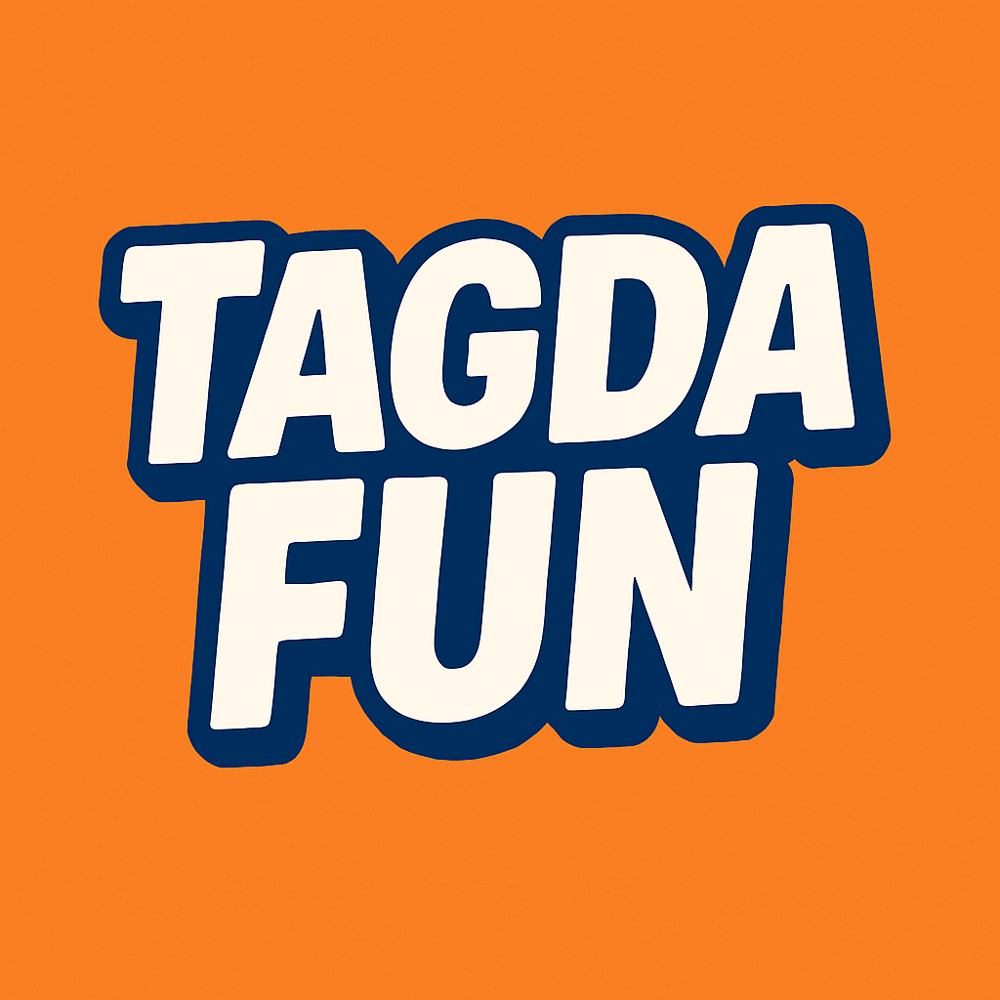

<div align="center">



# Tagda Fun

**Play. Challenge. Enjoy!**

[](https://github.com/DevmanushRaky/tagdafun)
[](https://github.com/DevmanushRaky/tagdafun/releases)
[](https://expo.dev)

</div>

---

## What is Tagda Fun?

Tagda Fun is a gamified mini-game app with three games — **Coin Toss**, **Memory Cards** and **Water Sorting** — wrapped in a full progression system with XP, levels, achievements, daily challenges, and a Shop where coins buy power-ups and skins. All data is stored locally on your device.

---

## Games

### Coin Toss — Free to play
- Pick **Heads** or **Tails**
- 3D animated coin flip
- Always earn **+5 coins** and **+10 XP** per flip
- Track your win streak and total flips

### Memory Cards — Free to play
- Flip cards and match all the pairs; earn **+10 coins** and **+15 XP** per cleared level
- **Levels** (saved between sessions): 4 cards per row, sized so the Hint button stays on screen: 4×3 (6 pairs) → 4×4 (8) → 4×4 (7 + 2 bombs) → 4×5 (9 + 2 bombs) → 4×5 (8 + 4 bombs) for every level after
- **Stars** by moves: 3★ within `ceil(pairs × 1.6)` moves, 2★ within `ceil(pairs × 2.4)`, else 1★. Best stars per level are saved
- **Bombs** (from Level 3): flipping one explodes it, adds +2 moves and reshuffles every unmatched card; matched pairs stay put
- **Hint** (2 per level): watch a rewarded ad and every card still in play is shown for 3 seconds. The clock pauses during the ad. In dev builds / Expo Go, where no ad loads, the hint is given for free so it can be tested
- **Music**: a soft looping melody (toggle 🎵 in the top bar, choice is saved); it pauses while an ad plays
- **Vibration** only when a level is cleared
- Tuning lives at the top of `components/MemoryCards.tsx` (`LEVELS`, `starLimits`, `BOMB_PENALTY_MOVES`, `HINTS_PER_LEVEL`, `HINT_REVEAL_MS`, `MUSIC_VOLUME`)

### Water Sorting — Free to play
- Pour water between bottles until every bottle holds a single colour
- Level-based, with hints; progress is saved between sessions
- Reward depends on your moves vs. par: **100 coins** at par, up to **150** if under par, down to **10** if far over
- Earn **+15 XP** per win
- **Hint** and **+ Bottle** each cost a rewarded ad. The hint is checked first, so no ad is shown when there is no useful move. The extra bottle (one per level) stays through Undo and Restart, since it was paid for
- Sounds: pour, a glass "ting" when a bottle is finished, a steel-drum jingle on a win, and a calm looping melody (toggle 🎵 in the header, saved). Music pauses during ads and dips under the win jingle
- Animations: bottles drop in at the start of a level (and on Restart), splash droplets where the stream lands, sparks when a bottle is finished, and a hop wave across the board before the result card
- **Vibration** only when a level is cleared

---

## Screens

| Screen | What it shows |
|--------|--------------|
| **Home** | Player card (level, XP bar, streak), daily challenge, game cards |
| **Coins** | Coin balance, per-game breakdown, full game history log |
| **Shop** | Daily gift, power-ups, coin skins and card backs bought with coins |
| **Profile** | Level progress, all-time stats, detailed game stats, achievements |

---

## Gamification System

### XP & Levels (11 levels)

| Level | Title | XP Needed |
|-------|-------|-----------|
| 1 | Newbie | 0 |
| 2 | Starter | 100 |
| 3 | Explorer | 250 |
| 4 | Player | 500 |
| 5 | Fun Seeker | 850 |
| 6 | Challenger | 1,300 |
| 7 | Pro Player | 1,900 |
| 8 | Champion | 2,700 |
| 9 | Legend | 3,700 |
| 10 | Mastermind | 5,000 |
| 11 | Grandmaster | 6,600 |

### Daily Challenge
- Flip the coin **5 times** every day
- On completion: **+25 coins + 20 XP**
- Resets at midnight

### Shop
Coins have no cash value; this is where they are spent. Catalog and prices live in `constants/shop.ts`, ownership in `contexts/ShopContext.tsx` (saved locally).

- **Daily gift**: free coins once a day, climbing 10 → 15 → 20 → 25 → 30 → 40 → 60 on consecutive days; a missed day starts over at day 1
- **Power-ups** (stack, used one at a time): Memory Hint 40, Water Hint 30, Extra Bottle 60. A game uses an owned power-up first and only falls back to a rewarded ad when you have none. The hint and bottle buttons show `×N` instead of `AD` while you own some
- **Coin skins** for Coin Toss (also shown on the Home card): Gold (free), Silver 300, Rose Gold 600, Emerald 1000, Diamond 2000
- **Card backs** for Memory Cards: Navy (free), Galaxy 400, Sunset 400, Ocean 700
- Every purchase asks for confirmation and is logged in the Coins history
- No random "mystery box": paid random rewards count as loot boxes on Google Play

### Achievements (11 total)

| Achievement | How to unlock | XP Reward |
|-------------|--------------|-----------|
| First Step | Play any game once | +50 XP |
| Coin Flipper | Flip coin 1 time | +30 XP |
| Getting Warmed Up | Play 10 games total | +75 XP |
| Addicted! | Play 50 games total | +200 XP |
| Centurion | Play 100 games total | +500 XP |
| Lucky Flipper | Win coin toss 5 times | +80 XP |
| Golden Touch | Win coin toss 20 times | +250 XP |
| On a Roll! | 3-day play streak | +100 XP |
| Week Warrior | 7-day play streak | +350 XP |
| Rising Star | Reach Level 5 | +200 XP |
| Legend Status | Reach Level 10 | +500 XP |

---

## Current Approach

The app runs fully offline using AsyncStorage — no backend, no login required.

**What works now:**
- All three games with full coin and XP logic
- Ads via Unity LevelPlay (banner, native, optional rewarded +50 coins) — see `ADS_INTEGRATION.md`
- Persistent stats, history, and achievements (AsyncStorage)
- Shop with daily gift, power-ups, coin skins and card backs
- Daily challenge with auto-reset
- 11-level XP progression

**Not planned:** no backend, login, online leaderboard or cash-out. Coins are in-game currency only; revenue comes from ads.

---

## Ads

Unity LevelPlay, all set up in code. Ad unit IDs, SDK quirks and build notes are in `ADS_INTEGRATION.md`.

| Format | Where | When |
|--------|-------|------|
| Banner | Home, below the daily challenge | Always |
| Native | Home (after games), inside each game screen, bottom of the Shop | Always (hidden until an ad loads) |
| Rewarded (+50 coins) | "Watch ad / Skip" popup after a game | **Capped**, see below |
| Rewarded (no coins) | Memory Cards "Hint" button | Player taps it; 2 per level |
| Rewarded (no coins) | Water Sorting "Hint" and "+ Bottle" | Player taps it; Hint any time, + Bottle once per level |

### After-game popup cap

Showing the popup after every round annoyed players and they just hit Skip, so it is capped:

- It shows after every **4th** finished game (any game, Coin Toss flips included)
- At most **once every 3 minutes**
- The counter lives in memory, so it resets when the app restarts

Change the numbers in `screens/HomeScreen.tsx`:

```ts
const REWARD_PROMPT_EVERY = 4;                   // show after every Nth finished game
const REWARD_PROMPT_COOLDOWN_MS = 3 * 60 * 1000; // at most once per this window
```

For Coin Toss the popup waits 1.5 s after the coin lands (`RESULT_HOLD_MS` in `components/CoinToss.tsx`) so the result is seen first.

Rewarded ads for in-game help go through `services/rewardedAd.ts` (`showRewardedAd()` → `'rewarded' | 'closed' | 'unavailable'`).

**Idea for later (not built):** an optional "2x coins" button on a win. With those in place the after-game popup could be removed completely.

---

## Getting Started

### Requirements
- Node.js 18+
- Expo CLI
- iOS Simulator / Android Emulator or physical device with Expo Go

### Run locally

```bash
git clone https://github.com/DevmanushRaky/tagdafun.git
cd tagdafun
npm ci
npm run start:go
```

Scan the QR code with **Expo Go** (phone and computer on the same WiFi).

> **Use `npm run start:go`, not plain `npx expo start`, for Expo Go.**
> The app uses the native LevelPlay ads SDK, which does not exist in Expo Go.
> `start:go` runs `EXPO_GO=1 expo start --go --lan --clear`, which makes `metro.config.js`
> swap in a no-op mock (`mocks/levelplay.js`). Without it, Expo Go crashes on launch with
> an `Uncaught Error: [runtime not ready]`. Ads therefore do not show in Expo Go.

For real ads, use a dev build instead: `npm run android` (or `npm run ios`, which needs a recent Xcode).
Expo Go only supports the latest Expo SDK, so keep the project's SDK in step with the Expo Go version on your phone.

---

## Build & Release

Uses [EAS Build](https://docs.expo.dev/build/introduction/) by Expo.

```bash
npm install -g eas-cli
eas login

# Android APK (testing)
eas build --platform android --profile preview

# Android AAB (Play Store)
eas build --platform android --profile production
```

---

## Project Structure

```
tagdafun/
├── App.tsx                     # Root: splash screen + 4-tab navigation
├── screens/
│   ├── HomeScreen.tsx          # Player card, daily challenge, game cards
│   ├── CoinsScreen.tsx         # Balance, game breakdown, history log
│   ├── ShopScreen.tsx          # Daily gift, power-ups, coin skins, card backs
│   └── ProfileScreen.tsx       # Level, all-time stats, achievements
├── components/
│   ├── CoinToss.tsx            # Animated coin flip game
│   ├── MemoryCards.tsx         # Card matching game
│   └── WaterSorting.tsx        # Water sort puzzle
├── contexts/
│   └── GameStatsContext.tsx    # XP, coins, level, achievements (AsyncStorage)
├── constants/
│   └── theme.ts                # Colors, typography, shadows, spacing
├── utils/
│   └── gameHistory.ts          # Per-game history log (AsyncStorage)
└── types/
    └── index.ts                # Navigation types + GAMES config
```

---

## Tech Stack

| Tool | Details |
|------|---------|
| React Native | Expo SDK ~53 |
| TypeScript | ~5.3.3 |
| expo-linear-gradient | Gradients throughout |
| @expo/vector-icons | Ionicons — no emojis in UI |
| @react-navigation/bottom-tabs | 4-tab navigation |
| AsyncStorage | Persist all stats, history, shop items |
| react-native-safe-area-context | Safe area insets |

---

## Android Info

- **Package:** `com.tagdafun.app`
- **Version:** `1.2.0`
- **Target SDK:** 36
- **Min SDK:** 24

---

## Credits

All sounds and music are **CC0 (public domain)**: free for commercial use, no attribution required. Sources, authors and what was changed are listed in [`assets/sounds/CREDITS.md`](assets/sounds/CREDITS.md):

- Coin sounds: Enci23 and Vinrax (OpenGameArt), Kenney
- Memory Cards music: "Happy Lullaby" by cynicmusic (OpenGameArt). The author asks to be told when the track is used
- Water Sorting sounds and music: ezwa (pdsounds), Kenney, Juhani Junkala

Keep `CREDITS.md` up to date whenever a sound is added or swapped, and only add CC0 files.

---

## License

MIT © [DevmanushRaky](https://github.com/DevmanushRaky/tagdafun)
